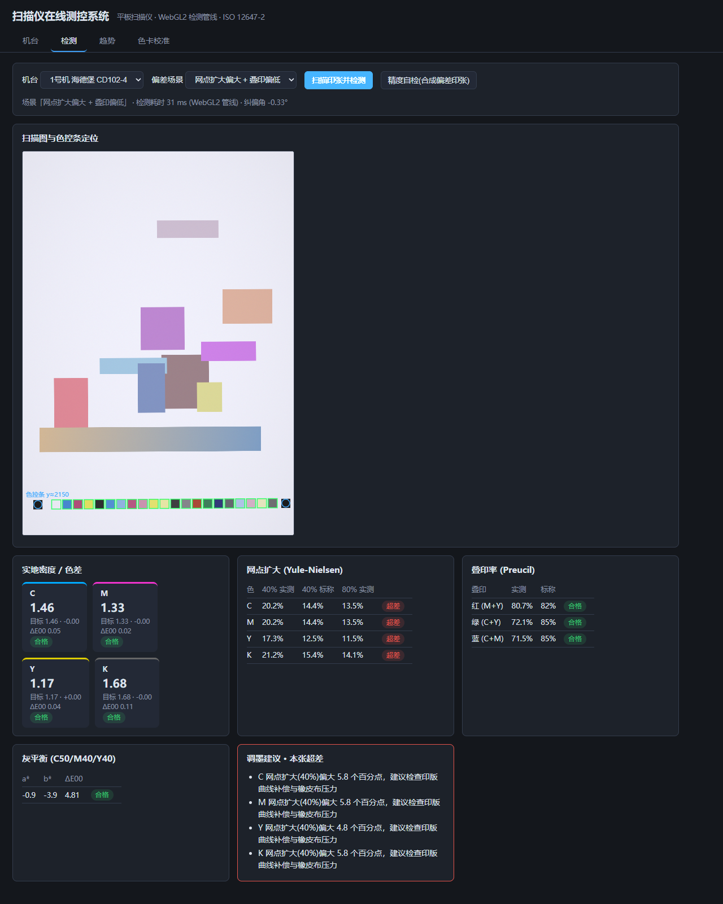

# 扫描仪在线测控系统

用平板扫描仪替代机台旁排队使用的分光密度计:扫描印张后自动定位色控条,
逐块计算实地密度、网点扩大、叠印率与灰平衡,按 ISO 12647-2 目标值判定,
超差色块给出调墨建议。计算管线基于 WebGL2,应用层为 TypeScript。



## 运行

```bash
npm install
npm run dev      # 开发
npm run build    # 构建到 dist/
npm run check    # 类型检查
```

## 页面

- **机台页**: 各印刷机状态、最近测量密度、合格率、调墨建议一览,可跳转检测。
- **检测页**: 扫描印张(本系统以物理模型合成测试印张)→ WebGL2 检测 →
  密度/ΔE/TVI/叠印率/灰平衡判定 → 调墨建议;「精度自检」按多种墨量偏差
  合成 12 张印张验证三项指标。
- **趋势页**: 实地密度 / ΔE00 / 网点扩大控制图(含控制限)。
- **色卡校准页**: 扫描仪特性化 —— 扫描标准色卡(32 级中性梯尺 + 64 色
  CMY 网格 + 4 级 K),拟合每通道单调三次逆色调曲线 LUT + 加权最小二乘
  3×3 矩阵,显示复测残差。

## 精度指标(自检实测,GPU 管线,12 张偏差印张)

| 指标 | 要求 | 实测最差 |
|---|---|---|
| 密度读数与分光密度计(模型真值)之差 | ≤ 0.03 | 0.005 |
| 色块测量 Lab 与真值之差 ΔE00 | ≤ 1.5 | 0.22 |
| 单张检测耗时 | < 1 s | ~30 ms |

## 架构

```
src/
  color/colorscience.ts   波段→XYZ→Lab、CIEDE2000、密度、Yule-Nielsen
  color/iso12647.ts       ISO 12647-2 目标值/容差/判定/调墨建议
  sim/model.ts            印刷机物理模型(Neugebauer + Yule-Nielsen + 叠印率)
  sim/scanner.ts          扫描仪响应模型(串扰/伽马/眩光/噪声)
  sim/sheetSynth.ts       测试印张合成(色块浮点直写, 避免中间量化)
  calib/calibration.ts    色卡特性化: 单调三次 LUT + 加权 3×3 矩阵
  detect/geometry.ts      色控条几何检测(标记定位 + 纠偏)
  detect/cpuSampler.ts    CPU 采样器(兜底/交叉校验)
  gpu/gpuSampler.ts       WebGL2 采样器: 轮廓约简 + 逐块 Lab/密度着色器
  detect/selftest.ts      精度自检(多场景偏差合成 + 指标比对)
  ui/                     四个页面
tools/
  tune.mjs                求解油墨分光密度常数使实地 Lab 命中 ISO 目标
  verify.mjs              无头浏览器精度验证(内置静态服务器)
  e2e.mjs                 页面交互端到端验证
  diagnose.ts/diagnose2.ts 校准残差诊断(纯计算/全链路)
```

### 关键设计

- **波段模型**: 三波段反射率经标定矩阵映射 XYZ(tools/tune.mjs 反解,
  使 C/M/Y/K 实地 Lab 精确命中 ISO 12647-2 涂布纸目标值, 实地密度
  C1.40/M1.27/Y1.16/K1.62 处于常规水平)。
- **真值与测量分离**: 真值由物理模型直接计算(相当于分光密度计),
  测量走 扫描仪模型 → 色卡校准 → WebGL2 管线 的完整链路, 两者独立。
- **色块浮点直写**: 色块颜色不经过 canvas 8bit 中间表示(否则整块颜色
  带系统性量化偏移, 区域平均无法消除), 量化只在最终扫描输出发生一次,
  且噪声在前使其随机化。
- **LUT 连续查找**: GPU/CPU 两侧对 256 级 LUT 均做线性插值,
  避免暗部(相邻梯级仅差 2 个数字量)阶梯量化误差。
- **暗角校正**: 合成端乘性暗角, 检测端按模型逐像素校正(与校准色卡一致)。
